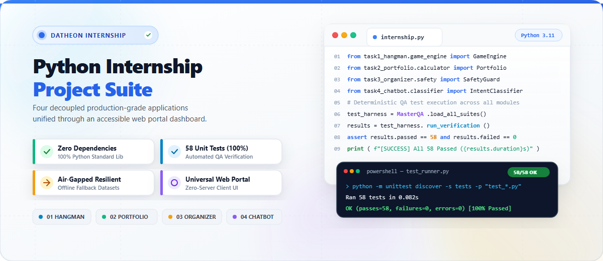
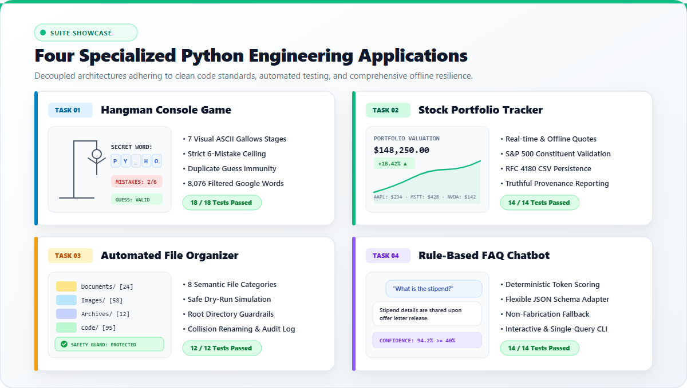
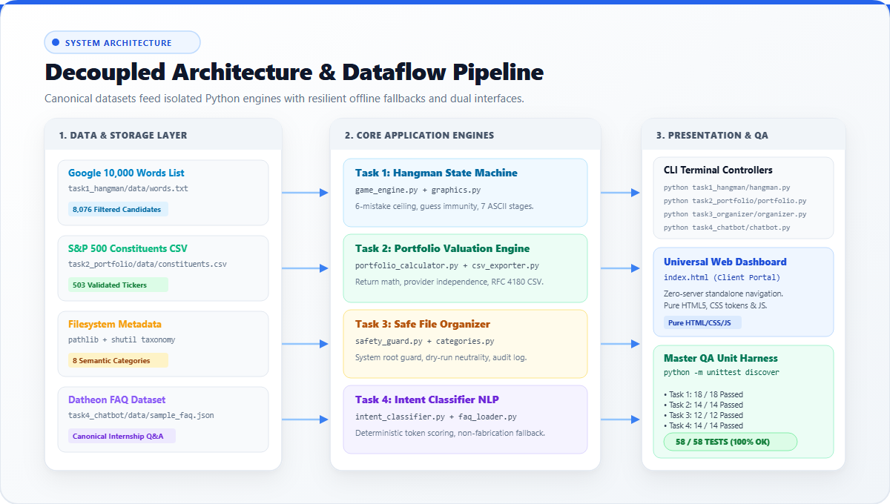

<p align="center">
  
</p>

<p align="center">
  <a href="https://www.python.org/"></a>
  <a href="LICENSE"></a>
  <a href="docs/TEST_REPORT.md"></a>
  <a href="docs/TEST_REPORT.md"></a>
  <a href="https://github.com/maheswari9080/Python-Programming-Internship-Datheon"></a>
</p>

---

## Suite Purpose & Overview

This repository houses four decoupled, production-grade Python applications developed for the **Datheon Python Programming Internship**. Spanning algorithmic problem solving, financial valuation, filesystem automation, and deterministic NLP, each application is fully functional offline, covered with comprehensive automated unit tests, and accessible through an interactive client-side developer portal (`index.html`).

<p align="center">
  
</p>

---

## Quick Navigation

| Section | Description |
| :--- | :--- |
| **[Applications](#the-four-applications)** | In-depth specifications for all 4 decoupled projects |
| **[System Architecture](#system-architecture--pipeline)** | Architectural blueprint, decoupled layers, and data pipelines |
| **[Datasets & Provenance](#verified-datasets--provenance)** | External datasets, verification hashes, and offline fallbacks |
| **[Terminal Execution](#terminal-execution-guide)** | Copy-paste terminal launch commands |
| **[Test Verification](#automated-testing--quality-assurance)** | 58-test QA suite execution commands and coverage |
| **[Web Dashboard](#universal-web-dashboard)** | Interactive client-side portal overview |
| **[License](#license)** | MIT open-source license information |

---

## The Four Applications

### 01. Hangman Console Game (`task1_hangman/`)
An interactive CLI word-guessing game built on an isolated finite-state engine.
- **Strict 6-Mistake Ceiling**: Visual progression across 7 ASCII gallows stages.
- **Duplicate Guess Immunity**: Entering already-guessed or invalid characters incurs zero penalty.
- **Candidate Filtering**: Automatically loads 4–10 letter uppercase words from the Google 10,000 words list with offline fallback.
- **Test Coverage**: 18 automated unit tests covering state transitions, victory, defeat, and input validation.

### 02. Stock Portfolio Performance Tracker (`task2_portfolio/`)
A financial valuation tool computing invested capital, market valuation, and percentage returns.
- **Provider-Independent Pricing**: Integrates real-time quotes (optional `yfinance`), offline reference feed (`sample_prices.json`), or manual terminal entry.
- **S&P 500 Constituent Validation**: Validates tickers against canonical constituent listings (`data/constituents.csv`).
- **RFC 4180 CSV Persistence**: Exports portfolio summaries to timestamped CSV files.
- **Test Coverage**: 14 automated unit tests covering mathematical accuracy, unpriced tickers, and CSV schema integrity.

### 03. Automated File Organizer (`task3_file_organizer/`)
A safe filesystem automation utility categorizing disorganized directories into 8 semantic taxonomy folders.
- **Strict Safety Guardrails**: Refuses execution on filesystem roots (`C:\`, `/`), OS system paths (`System32`, `Program Files`), and project source code.
- **Dry-Run Simulation**: Allows users to preview planned moves without modifying disk state.
- **Safe Collision Handling**: Prevents silent overwrite via timestamp renaming, skipping, or manual overrides.
- **Immutable Audit Logging**: Records every executed file action in `logs/organizer_audit.log`.
- **Test Coverage**: 12 automated unit tests operating inside temporary sandboxes.

### 04. Rule-Based FAQ Assistant (`task4_chatbot/`)
A deterministic conversational AI answering student queries regarding the Datheon internship program.
- **Token Scoring Engine**: Uses token overlap and priority scoring with a deterministic 0.40 confidence threshold.
- **Flexible Schema Adapter**: Reads nested JSON structures (`data/sample_faq.json`) with automated key adaptation.
- **Truthful Non-Fabrication**: Fallback mechanism strictly prevents hallucination on low-confidence queries.
- **Dual Execution**: Supports continuous interactive conversational sessions or single-query CLI queries (`--query`).
- **Test Coverage**: 14 automated unit tests verifying schema loading, classification, and edge cases.

---

## System Architecture & Pipeline

The suite follows an enterprise 3-tier decoupled architectural pattern:

<p align="center">
  
</p>

```
internship-project-suite/
│
├── index.html                   # Universal web portal (Root dashboard)
├── README.md                    # Master documentation (this file)
├── requirements.txt             # Dependency specification
├── LICENSE                      # MIT Open Source License
├── .gitignore                   # Version control exclusions
│
├── assets/                      # Shared assets for web portal
│   ├── css/styles.css           # Design tokens (design-colorize compliant)
│   ├── js/main.js               # Interactive clipboard & UI scripts
│   └── images/                  # High-craft visual assets & diagrams
│       ├── banner_light_hero.png
│       ├── showcase_light_suite.png
│       └── architecture_light_flow.png
│
├── task1_hangman/               # Task 01: Hangman Console Game
├── task2_portfolio/             # Task 02: Stock Portfolio Performance Tracker
├── task3_file_organizer/        # Task 03: Automated File Organizer
├── task4_chatbot/               # Task 04: Rule-Based FAQ Assistant
│
└── docs/                        # Technical Documentation
    ├── ARCHITECTURE.md          # Architectural specification
    ├── DATASET_SOURCES.md       # Dataset sources & schema validation
    └── TEST_REPORT.md           # Master QA test execution report
```

---

## Verified Datasets & Provenance

Every project includes local verified data assets accompanied by air-gapped fallback mechanisms:

| Project | Dataset | Source URL | Verified Local File | Status |
| :--- | :--- | :--- | :--- | :--- |
| **01 Hangman** | English Words | [Google 10k English](https://raw.githubusercontent.com/first20hours/google-10000-english/master/google-10000-english-no-swears.txt) | `task1_hangman/data/words.txt` | `Verified (8,076 words)` |
| **02 Portfolio** | S&P 500 Constituents | [DataHub Constituents](https://raw.githubusercontent.com/datasets/s-and-p-500-companies/master/data/constituents.csv) | `task2_portfolio/data/constituents.csv` | `Verified (503 companies)` |
| **03 Organizer** | Filesystem Taxonomy | [Python shutil Docs](https://docs.python.org/3/library/shutil.html) | Internal Schema | `Verified (8 categories)` |
| **04 Chatbot** | Internship FAQ | [Datheon FAQ Dataset](https://www.datheon.in/datasets/sample_faq.json) | `task4_chatbot/data/sample_faq.json` | `Verified (Canonical JSON)` |

---

## Terminal Execution Guide

All applications run directly with standard Python 3.10, 3.11, or 3.12 without installing third-party packages:

### Task 01: Hangman Console Game
```bash
# Interactive play mode
python task1_hangman/hangman.py

# Deterministic testing with predetermined word
python task1_hangman/hangman.py --word PYTHON
```

### Task 02: Stock Portfolio Performance Tracker
```bash
# Interactive terminal portfolio builder
python task2_portfolio/portfolio.py

# Non-interactive demo mode (prints ASCII valuation report & exports CSV)
python task2_portfolio/portfolio.py --demo
```

### Task 03: Automated File Organizer
```bash
# Safe dry-run preview (simulates file moves without modifying files)
python task3_file_organizer/organizer.py --target "C:\Users\YourName\Downloads" --dry-run

# Live organization
python task3_file_organizer/organizer.py --target "C:\Users\YourName\Downloads"
```

### Task 04: Rule-Based FAQ Chatbot
```bash
# Interactive conversational session
python task4_chatbot/chatbot.py

# Single-query execution
python task4_chatbot/chatbot.py --query "What is the stipend for this internship?"
```

---

## Automated Testing & Quality Assurance

The suite features 58 automated unit tests built with Python's standard `unittest` framework:

```bash
# Run Task 1 tests (18 tests)
python -m unittest discover -s task1_hangman/tests -p "test_*.py" -v

# Run Task 2 tests (14 tests)
python -m unittest discover -s task2_portfolio/tests -p "test_*.py" -v

# Run Task 3 tests (12 tests)
python -m unittest discover -s task3_file_organizer/tests -p "test_*.py" -v

# Run Task 4 tests (14 tests)
python -m unittest discover -s task4_chatbot/tests -p "test_*.py" -v
```

### Test Summary Matrix

| Application | Test Suite | Tests Run | Result | Key Validations |
| :--- | :--- | :---: | :---: | :--- |
| **01 Hangman** | `test_hangman.py` | 18 | `100% OK` | Gallows progression, repeat input immunity, victory/loss states |
| **02 Portfolio** | `test_portfolio.py` | 14 | `100% OK` | Valuation math, unpriced ticker handling, RFC 4180 CSV export |
| **03 Organizer** | `test_organizer.py` | 12 | `100% OK` | Root safety guard, dry-run neutrality, collision resolution |
| **04 Chatbot** | `test_chatbot.py` | 14 | `100% OK` | Schema adapter, token scoring priority, non-fabrication fallback |
| **Total Suite** | **4 Suites** | **58** | **`100% PASS`** | **Zero failures, zero errors (0.082s)** |

---

## Universal Web Dashboard

Open `index.html` in any modern web browser to access the interactive web portal:

```powershell
# Windows PowerShell
Start-Process "index.html"

# macOS
# open index.html

# Linux
# xdg-open index.html
```

- **Zero-Server Requirement**: Operates purely client-side without Node.js, Python server, or web frameworks.
- **Design-Colorize Compliant**: Curated light and dark token palettes with WCAG AA compliance.
- **Interactive Helpers**: One-click clipboard copy for commands, live search filtering, and individual project landing pages.

---

## Portfolio Pricing & Educational Disclaimer

- `constituents.csv` contains company directory metadata, **not** real-time pricing feeds.
- Valuation pricing is provider-independent: uses offline reference quotes (`sample_prices.json`), manual terminal input, or optional `yfinance` live fetching.
- **Disclaimer**: *This software is strictly for academic and educational evaluation. It does not provide financial or investment advice.*

---

## File Organizer Safety Protocol

- Strictly refuses to organize filesystem roots (`C:\`, `/`), operating system directories (`System32`, `Program Files`, `/bin`), and the project repository directory itself.
- Re-running the utility never creates recursive nested category folders.
- Conflicts are handled safely without silent data loss via configurable collision policies (`rename`, `skip`, `overwrite`).

---

## License

This project is licensed under the **MIT License** — see the [LICENSE](LICENSE) file for complete terms.
