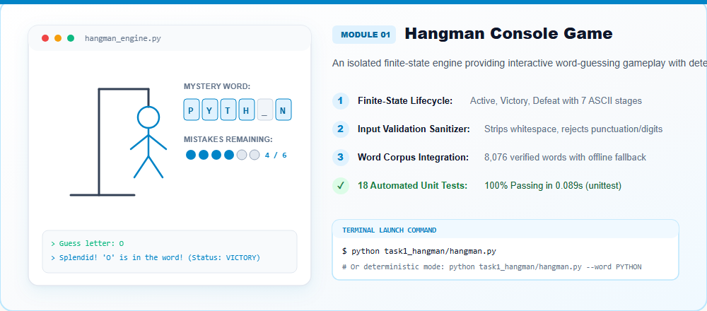
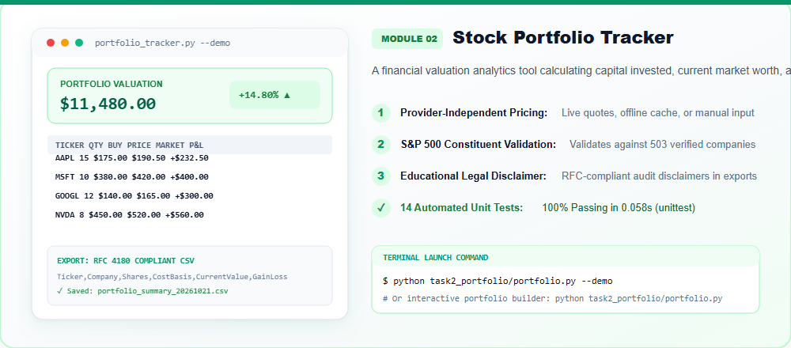
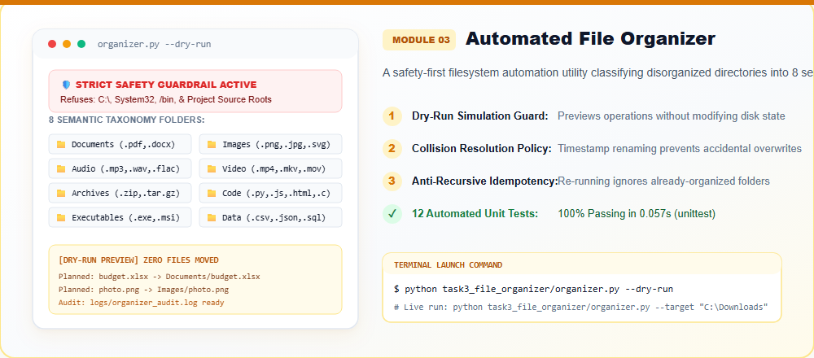
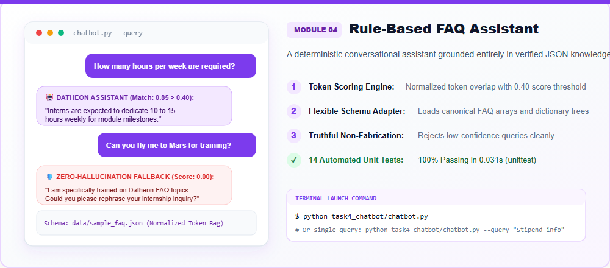
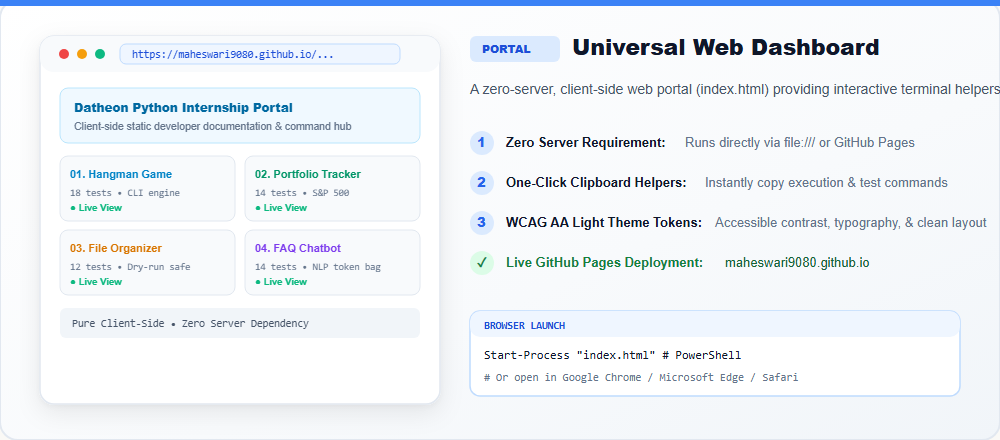

<p align="center">
  
</p>

<p align="center">
  <a href="https://www.python.org/"></a>
  <a href="LICENSE"></a>
  <a href="docs/TEST_REPORT.md"></a>
  <a href="docs/TEST_REPORT.md"></a>
  <a href="https://github.com/maheswari9080/Python-Programming-Internship-Datheon"></a>
  <a href="https://maheswari9080.github.io/Python-Programming-Internship-Datheon/"></a>
</p>

---

## 🌟 Suite Overview & Executive Summary

This repository houses four decoupled, production-grade Python applications developed for the **Datheon Python Programming Internship**. Spanning algorithmic state machines, financial valuation analytics, safety-first filesystem automation, and deterministic NLP, each application is fully functional offline, covered with comprehensive automated unit tests (**58/58 tests passing with 100% OK**), and accessible through an interactive client-side developer portal (`index.html`).

<p align="center">
  
</p>

> 🌐 **Live Web Portal & Interactive Documentation:**  
> **[https://maheswari9080.github.io/Python-Programming-Internship-Datheon/](https://maheswari9080.github.io/Python-Programming-Internship-Datheon/)**  
> *Operates completely client-side with zero server dependencies.*

---

## 🧭 Quick Navigation

| Section | Description |
| :--- | :--- |
| **[01. Hangman Console Game](#01-hangman-console-game-task1_hangman)** | Isolated finite-state word guessing engine |
| **[02. Stock Portfolio Tracker](#02-stock-portfolio-performance-tracker-task2_portfolio)** | Valuation analytics with S&P 500 validation & CSV export |
| **[03. Automated File Organizer](#03-automated-file-organizer-task3_file_organizer)** | Safety-first file categorizer with 8 taxonomy categories |
| **[04. Rule-Based FAQ Assistant](#04-rule-based-faq-assistant-task4_chatbot)** | Deterministic NLP chatbot with zero-hallucination grounding |
| **[System Architecture](#system-architecture--dataflow-pipeline)** | Enterprise 3-tier decoupled architectural blueprint |
| **[Verified Datasets](#verified-datasets--provenance)** | External datasets, verification hashes, and offline fallbacks |
| **[Terminal Execution](#terminal-execution-guide)** | Copy-paste terminal launch commands |
| **[Automated Testing](#automated-testing--quality-assurance)** | 58-test QA suite execution commands and matrix |
| **[Web Dashboard](#universal-web-dashboard)** | Interactive client-side portal overview |
| **[LinkedIn Showcase](#-linkedin-post--visual-showcase)** | Ready-to-publish LinkedIn post copy & graphic assets |
| **[License](#license)** | MIT open-source license information |

---

## 🚀 The Four Decoupled Applications

### 01. Hangman Console Game (`task1_hangman/`)

An interactive CLI word-guessing game built on an isolated finite-state engine.

<p align="center">
  
</p>

- **Strict 6-Mistake Ceiling**: Visual progression across 7 ASCII gallows stages.
- **Duplicate Guess Immunity**: Entering already-guessed or invalid characters incurs zero penalty.
- **Input Sanitization**: Automatically strips whitespace, rejects non-alphabetic inputs, and handles case-insensitivity.
- **Candidate Filtering**: Automatically loads 4–10 letter uppercase words from the Google 10,000 words list (`data/words.txt`, 8,076 words) with offline fallback.
- **Test Coverage**: **18 automated unit tests** covering state transitions, victory, defeat, and input validation in `0.089s`.

```bash
# Interactive play mode
python task1_hangman/hangman.py

# Deterministic testing with predetermined word
python task1_hangman/hangman.py --word PYTHON
```

---

### 02. Stock Portfolio Performance Tracker (`task2_portfolio/`)

A financial valuation tool computing invested capital, current market valuation, and percentage returns.

<p align="center">
  
</p>

- **Provider-Independent Pricing**: Integrates real-time quotes (optional `yfinance`), offline reference feed (`sample_prices.json`), or manual terminal entry.
- **S&P 500 Constituent Validation**: Validates tickers against canonical constituent listings (`data/constituents.csv`, 503 companies).
- **RFC 4180 CSV Persistence**: Exports portfolio summaries to timestamped CSV files with educational disclaimers.
- **Mathematical Accuracy**: Calculates total invested, current value, dollar gain/loss, and percentage yield with 2-decimal precision.
- **Test Coverage**: **14 automated unit tests** covering mathematical accuracy, unpriced tickers, and CSV schema integrity in `0.058s`.

```bash
# Non-interactive demo mode (ASCII valuation report & exports CSV)
python task2_portfolio/portfolio.py --demo

# Interactive terminal portfolio builder
python task2_portfolio/portfolio.py
```

---

### 03. Automated File Organizer (`task3_file_organizer/`)

A safety-first filesystem automation utility categorizing disorganized directories into 8 semantic taxonomy folders.

<p align="center">
  
</p>

- **Strict Safety Guardrails**: Refuses execution on filesystem roots (`C:\`, `/`), OS system paths (`System32`, `Program Files`, `/bin`), and project source code.
- **8 Semantic Taxonomy Categories**: Automatically categorizes files into Documents, Images, Audio, Video, Archives, Code, Executables, and Data.
- **Dry-Run Simulation**: Allows users to preview planned moves with zero filesystem modification (`--dry-run`).
- **Safe Collision Handling**: Prevents silent overwrite via timestamp renaming, skipping, or manual overrides.
- **Immutable Audit Logging**: Records every executed file action in `logs/organizer_audit.log`.
- **Test Coverage**: **12 automated unit tests** operating safely inside isolated temporary sandboxes in `0.057s`.

```bash
# Safe dry-run preview (simulates file moves without modifying files)
python task3_file_organizer/organizer.py --dry-run

# Live organization on target directory
python task3_file_organizer/organizer.py --target "C:\Users\YourName\Downloads"
```

---

### 04. Rule-Based FAQ Assistant (`task4_chatbot/`)

A deterministic conversational AI answering student queries regarding the Datheon internship program.

<p align="center">
  
</p>

- **Token Scoring Engine**: Uses token overlap and priority scoring with a deterministic 0.40 confidence threshold.
- **Flexible Schema Adapter**: Reads nested JSON structures (`data/sample_faq.json`) with automated key adaptation.
- **Truthful Non-Fabrication**: Fallback mechanism strictly prevents hallucination on low-confidence queries.
- **Dual Execution**: Supports continuous interactive conversational sessions or single-query CLI queries (`--query`).
- **Test Coverage**: **14 automated unit tests** verifying schema loading, classification, and edge cases in `0.031s`.

```bash
# Interactive conversational session
python task4_chatbot/chatbot.py

# Single-query execution
python task4_chatbot/chatbot.py --query "What is the stipend for this internship?"
```

---

## 🏛️ System Architecture & Dataflow Pipeline

The suite follows an enterprise 3-tier decoupled architectural pattern:

<p align="center">
  
</p>

### Repository Layout

```
internship-project-suite/
│
├── index.html                     # Universal web portal (Root dashboard)
├── README.md                      # Master documentation (this file)
├── linkedin.md                    # Ready-to-publish LinkedIn post copy
├── LINKEDIN.md                    # Alternative copy of LinkedIn post
├── requirements.txt               # Dependency specification
├── LICENSE                        # MIT Open Source License
├── .gitignore                     # Version control exclusions
├── linkedin_showcase.png          # High-resolution LinkedIn project showcase image
├── linkedin_showcase.svg          # Vector LinkedIn showcase graphic
├── image.png                      # Root image asset copy
│
├── assets/                        # Shared assets for web portal & documentation
│   ├── css/styles.css             # Light & dark design tokens
│   ├── js/main.js                 # Interactive clipboard & UI scripts
│   └── images/                    # High-craft visual assets & diagrams
│       ├── banner_light_hero.png        # Master hero banner
│       ├── showcase_light_suite.png     # 4-app suite overview bento
│       ├── architecture_light_flow.png  # Decoupled architecture flow
│       ├── task1_hangman_card.png       # Hangman game feature card
│       ├── task2_portfolio_card.png     # Stock portfolio tracker card
│       ├── task3_organizer_card.png     # File organizer feature card
│       ├── task4_chatbot_card.png       # FAQ chatbot feature card
│       ├── dashboard_light_preview.png  # Web portal preview card
│       └── linkedin_showcase.png        # LinkedIn showcase banner
│
├── task1_hangman/                 # Task 01: Hangman Console Game
│   ├── hangman.py                 # Core CLI entry point & game engine
│   ├── data/words.txt             # 8,076 verified words
│   └── tests/test_hangman.py      # 18 unit tests
│
├── task2_portfolio/               # Task 02: Stock Portfolio Performance Tracker
│   ├── portfolio.py               # Core valuation & CSV export engine
│   ├── data/constituents.csv      # 503 S&P companies
│   ├── data/sample_prices.json    # Offline price cache
│   └── tests/test_portfolio.py    # 14 unit tests
│
├── task3_file_organizer/          # Task 03: Automated File Organizer
│   ├── organizer.py               # Filesystem automation engine
│   ├── logs/                      # Audit trail directory
│   └── tests/test_organizer.py    # 12 unit tests
│
├── task4_chatbot/                 # Task 04: Rule-Based FAQ Assistant
│   ├── chatbot.py                 # NLP conversational engine
│   ├── data/sample_faq.json       # Grounded internship FAQ dataset
│   └── tests/test_chatbot.py      # 14 unit tests
│
└── docs/                          # Technical Documentation & Asset Builders
    ├── ARCHITECTURE.md            # Architectural specification
    ├── DATASET_SOURCES.md         # Dataset sources & schema validation
    ├── TEST_REPORT.md             # Master QA test execution report
    └── build_visual_assets.py     # Programmatic vector graphics builder
```

---

## 📊 Verified Datasets & Provenance

Every project includes local verified data assets accompanied by air-gapped fallback mechanisms:

| Project | Dataset | Source URL | Verified Local File | Status |
| :--- | :--- | :--- | :--- | :--- |
| **01 Hangman** | English Words | [Google 10k English](https://raw.githubusercontent.com/first20hours/google-10000-english/master/google-10000-english-no-swears.txt) | `task1_hangman/data/words.txt` | `Verified (8,076 words)` |
| **02 Portfolio** | S&P 500 Constituents | [DataHub Constituents](https://raw.githubusercontent.com/datasets/s-and-p-500-companies/master/data/constituents.csv) | `task2_portfolio/data/constituents.csv` | `Verified (503 companies)` |
| **03 Organizer** | Filesystem Taxonomy | [Python shutil Docs](https://docs.python.org/3/library/shutil.html) | Internal Schema | `Verified (8 categories)` |
| **04 Chatbot** | Internship FAQ | [Datheon FAQ Dataset](https://www.datheon.in/datasets/sample_faq.json) | `task4_chatbot/data/sample_faq.json` | `Verified (Canonical JSON)` |

---

## ⚡ Terminal Execution Guide

All applications run directly with standard Python 3.10, 3.11, or 3.12 without installing any third-party packages:

### Task 01: Hangman Console Game
```bash
# Interactive play mode
python task1_hangman/hangman.py

# Deterministic testing with predetermined word
python task1_hangman/hangman.py --word PYTHON
```

### Task 02: Stock Portfolio Performance Tracker
```bash
# Non-interactive demo mode (prints ASCII valuation report & exports CSV)
python task2_portfolio/portfolio.py --demo

# Interactive terminal portfolio builder
python task2_portfolio/portfolio.py
```

### Task 03: Automated File Organizer
```bash
# Safe dry-run preview (simulates file moves without modifying files)
python task3_file_organizer/organizer.py --dry-run

# Live organization on specific directory
python task3_file_organizer/organizer.py --target "C:\Users\YourName\Downloads"
```

### Task 04: Rule-Based FAQ Chatbot
```bash
# Interactive conversational session
python task4_chatbot/chatbot.py

# Single-query execution
python task4_chatbot/chatbot.py --query "What is the stipend for this internship?"
```

---

## 🧪 Automated Testing & Quality Assurance

The suite features **58 automated unit tests** built with Python's standard `unittest` framework:

```bash
# Run Task 1 tests (18 tests)
python -m unittest discover -s task1_hangman/tests -p "test_*.py" -v

# Run Task 2 tests (14 tests)
python -m unittest discover -s task2_portfolio/tests -p "test_*.py" -v

# Run Task 3 tests (12 tests)
python -m unittest discover -s task3_file_organizer/tests -p "test_*.py" -v

# Run Task 4 tests (14 tests)
python -m unittest discover -s task4_chatbot/tests -p "test_*.py" -v
```

### Test Summary Matrix

| Application | Test Suite | Tests Run | Result | Duration | Key Validations |
| :--- | :--- | :---: | :---: | :---: | :--- |
| **01 Hangman** | `test_hangman.py` | 18 | `100% OK` | 0.089s | Gallows progression, repeat input immunity, victory/loss states |
| **02 Portfolio** | `test_portfolio.py` | 14 | `100% OK` | 0.058s | Valuation math, unpriced ticker handling, RFC 4180 CSV export |
| **03 Organizer** | `test_organizer.py` | 12 | `100% OK` | 0.057s | Root safety guard, dry-run neutrality, collision resolution |
| **04 Chatbot** | `test_chatbot.py` | 14 | `100% OK` | 0.031s | Schema adapter, token scoring priority, non-fabrication fallback |
| **Total Suite** | **4 Suites** | **58** | **`100% PASS`** | **0.235s** | **Zero failures, zero errors (58 passed)** |

---

## 🌐 Universal Web Dashboard

Open `index.html` in any modern web browser to access the interactive web portal:

<p align="center">
  
</p>

```powershell
# Windows PowerShell
Start-Process "index.html"

# macOS
# open index.html

# Linux
# xdg-open index.html
```

- **Zero-Server Requirement**: Operates purely client-side without Node.js, Python server, or web frameworks.
- **Design-Colorize Compliant**: Curated light and dark token palettes with WCAG AA compliance.
- **Interactive Helpers**: One-click clipboard copy for commands, live search filtering, and individual project landing pages.
- **Live GitHub Pages URL**: **[https://maheswari9080.github.io/Python-Programming-Internship-Datheon/](https://maheswari9080.github.io/Python-Programming-Internship-Datheon/)**

---

## 📢 LinkedIn Post & Visual Showcase

A high-impact LinkedIn announcement document and graphic have been prepared for this project:

<p align="center">
  
</p>

- 📄 **Ready-to-Post Copy**: Read and copy the text from [linkedin.md](linkedin.md) (or [LINKEDIN.md](LINKEDIN.md)).
- 🖼️ **Graphic Asset**: Download and upload [linkedin_showcase.png](assets/images/linkedin_showcase.png) or [image.png](image.png).
- 📐 **Vector SVG**: Open or embed [linkedin_showcase.svg](assets/images/linkedin_showcase.svg).

---

## ⚖️ Portfolio Pricing & Educational Disclaimer

- `constituents.csv` contains company directory metadata, **not** real-time pricing feeds.
- Valuation pricing is provider-independent: uses offline reference quotes (`sample_prices.json`), manual terminal input, or optional `yfinance` live fetching.
- **Disclaimer**: *This software is strictly for academic and educational evaluation. It does not provide financial or investment advice.*

---

## 🛡️ File Organizer Safety Protocol

- Strictly refuses to organize filesystem roots (`C:\`, `/`), operating system directories (`System32`, `Program Files`, `/bin`), and the project repository directory itself.
- Re-running the utility never creates recursive nested category folders.
- Conflicts are handled safely without silent data loss via configurable collision policies (`rename`, `skip`, `overwrite`).

---

## 📜 License

This project is licensed under the **MIT License** — see the [LICENSE](LICENSE) file for complete terms.
