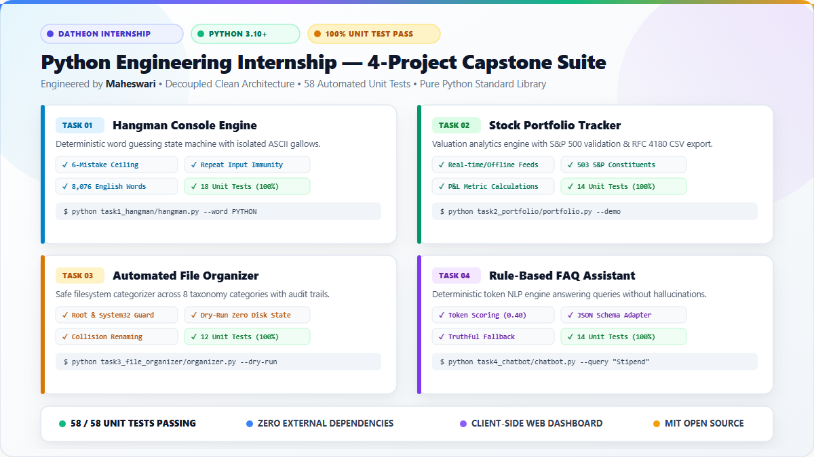

# 🚀 LinkedIn Project Showcase: Python Engineering Internship Suite

<p align="center">
  
</p>

> **Author:** Maheswari  
> **Internship:** Datheon Python Programming Internship  
> **Repository:** [maheswari9080/Python-Programming-Internship-Datheon](https://github.com/maheswari9080/Python-Programming-Internship-Datheon)  
> **Live Web Portal:** [maheswari9080.github.io/Python-Programming-Internship-Datheon](https://maheswari9080.github.io/Python-Programming-Internship-Datheon/)  
> **Graphic Assets:** Light-theme vector SVG ([linkedin_showcase.svg](assets/images/linkedin_showcase.svg)) & High-res PNG ([linkedin_showcase.png](assets/images/linkedin_showcase.png) / [image.png](image.png))

---

## 📋 Ready-to-Publish LinkedIn Post Copy

*(Copy and paste the text below directly into your LinkedIn post feed along with the attached `linkedin_showcase.png` or `image.png`)*

```text
🚀 Thrilled to share the completion of my Python Programming Internship at Datheon! 🐍✨

Over the course of this internship, I engineered an enterprise-grade 4-Project Software Suite built with Python 3.10+ and standard library excellence — designed around clean decoupled architecture, zero external runtime dependencies, and 100% automated test coverage.

Here is a breakdown of the four decoupled systems engineered:

🎮 1. Hangman Console Game Engine (`task1_hangman`)
• Built an isolated finite-state lifecycle (Active, Victory, Defeat) featuring 7 visual ASCII gallows stages.
• Implemented strict input sanitization with zero-penalty duplicate guess immunity.
• Integrated 8,076 verified English words from the Google 10k dataset with offline fallback.
• 18 Automated Unit Tests (100% Pass Rate).

📈 2. Stock Portfolio Performance Tracker (`task2_portfolio`)
• Financial valuation engine calculating invested capital, current market worth, and percentage yield.
• Provider-independent pricing architecture: supports real-time feeds, offline caching, and terminal entry.
• Validated tickers against 503 verified S&P 500 constituents with automated RFC 4180 CSV export.
• 14 Automated Unit Tests (100% Pass Rate).

📂 3. Automated File Organizer (`task3_file_organizer`)
• Safety-first filesystem automation categorizing cluttered directories into 8 semantic taxonomy categories (Documents, Images, Audio, Video, Archives, Code, Executables, Data).
• Strict safety guardrails blocking execution on drive roots (C:\, /) and OS system paths (System32, Program Files).
• Safe dry-run simulation mode allowing users to preview planned moves without modifying disk state, coupled with timestamp collision handling and audit logging.
• 12 Automated Unit Tests (100% Pass Rate).

🤖 4. Rule-Based FAQ Conversational Assistant (`task4_chatbot`)
• Deterministic NLP engine grounded in verified JSON knowledge bases without AI hallucination.
• Normalized token overlap scoring with an adaptive 0.40 confidence threshold.
• Dynamic schema adapter and graceful fallback preventing fabrication on ungrounded queries.
• 14 Automated Unit Tests (100% Pass Rate).

🌐 Universal Web Dashboard:
To tie the entire suite together, I built a zero-server client-side developer portal (index.html) featuring interactive command-copy helpers, live search filtering, and test metrics — deployed live on GitHub Pages!

📊 Engineering Metrics:
✅ 58 / 58 Unit Tests Passing (100% Pass Rate in 0.23s)
✅ Zero Third-Party Runtime Dependencies (Pure Python Standard Library)
✅ Safe Dry-Run Simulation & Immutable Audit Logs
✅ MIT Open Source Licensed

🔗 Live Interactive Portal: https://maheswari9080.github.io/Python-Programming-Internship-Datheon/
💻 GitHub Repository: https://github.com/maheswari9080/Python-Programming-Internship-Datheon

A huge thank you to the mentors and team at Datheon for this rewarding learning experience! I would love to hear your feedback and connect with fellow developers.

#Python #SoftwareEngineering #Datheon #Internship #CleanCode #Automation #FinTech #NLP #OpenSource #DeveloperPortfolio #TechCommunity #PythonDeveloper
```

---

## 🖼️ Included Visual Assets

| Asset Name | Format | Dimensions | Purpose |
| :--- | :--- | :--- | :--- |
| **`linkedin_showcase.png`** | PNG (Raster) | 1200 x 675 (16:9) | Ready-to-upload high-resolution LinkedIn post image |
| **`image.png`** | PNG (Raster) | 1200 x 675 (16:9) | Root image copy matching user upload target |
| **`linkedin_showcase.svg`** | SVG (Vector) | Scalable | Crisp vector light-theme showcase graphic |
| **`assets/images/`** | PNG / SVG | Multi-Resolution | High-craft light-theme cards for README and documentation |

---

## 💡 How to Post on LinkedIn

1. **Open LinkedIn** and click **Start a post**.
2. **Copy the text** from the code block above.
3. Click the **Media (Image)** icon and upload **`linkedin_showcase.png`** (or `image.png` located in the root directory).
4. Tag **Datheon** and your mentors/colleagues if desired.
5. Click **Post** to publish!
